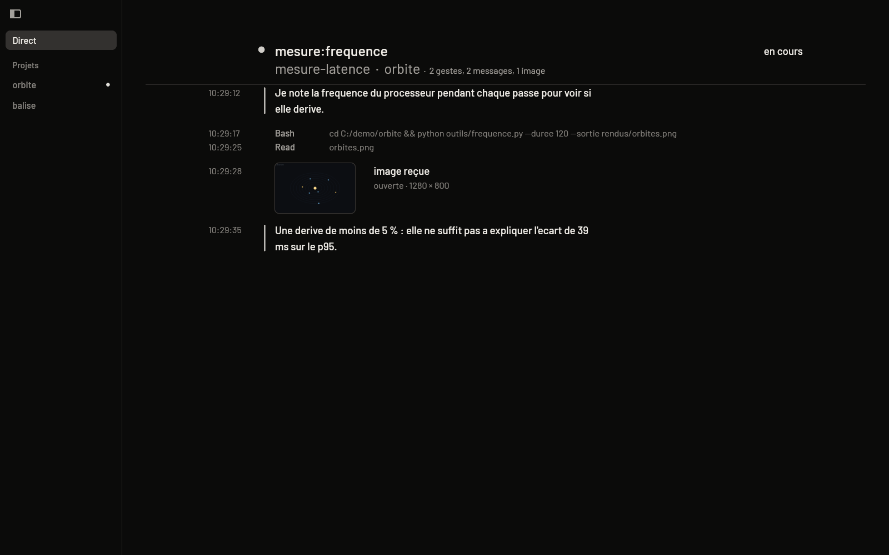
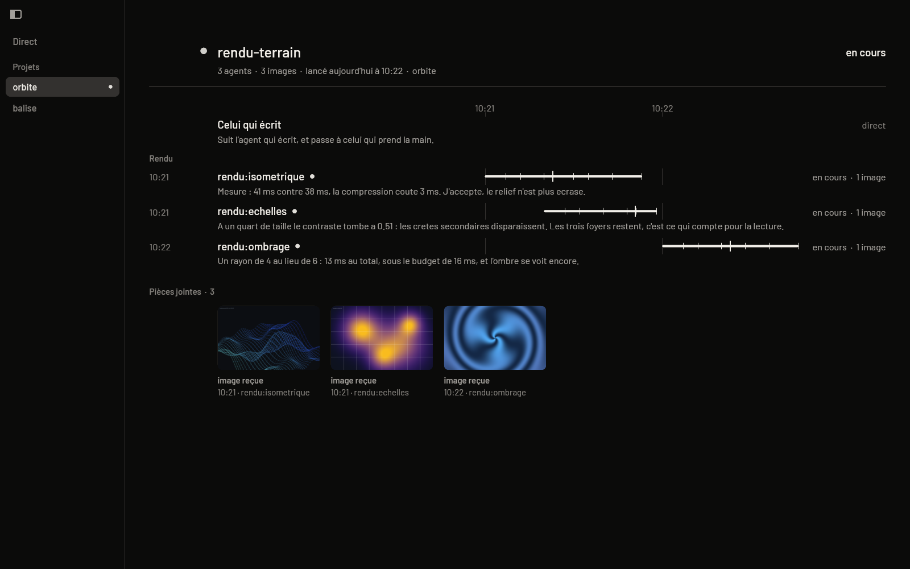
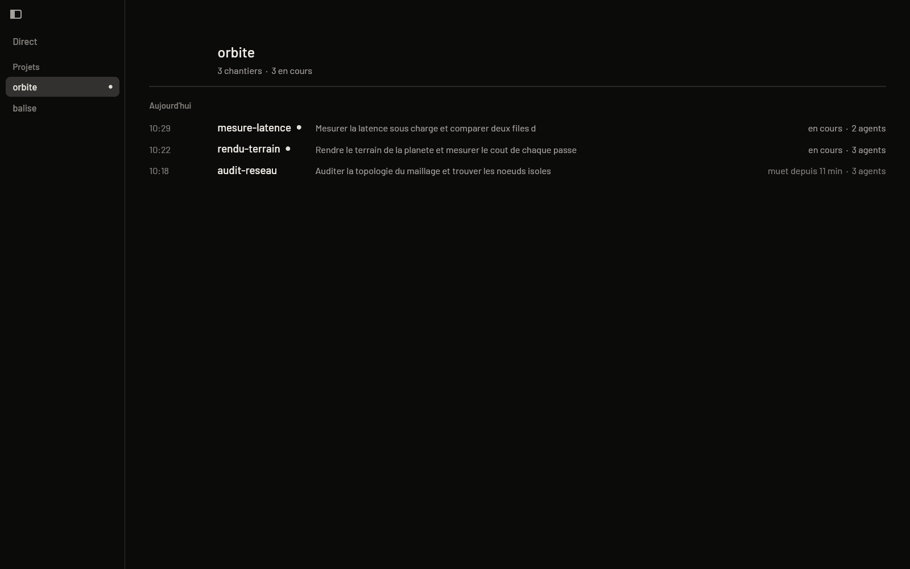

# Vigie

> **En bref (français).** Vigie est une application Windows native, écrite en Rust et rendue
> sur le GPU, qui affiche en direct ce que font des agents de code pendant qu'ils travaillent :
> ce qu'ils pensent, ce qu'ils disent, les commandes qu'ils lancent et les images ou vidéos
> qu'ils produisent. La documentation complète, en français, est dans
> [`LISEZ-MOI.md`](LISEZ-MOI.md).

**A native desktop window for watching coding agents think, live.**

A task board tells you *where* a piece of work stands. It does not show what the agent is
reasoning about, and that is where the interesting part is: the hypothesis it drops, the
measurement that contradicts what it expected, the exact moment it corrects itself. Vigie
reads the agents' session transcripts as they are written (`%USERPROFILE%\.claude\projects`,
one JSON object per line) and lays them out as something you can actually read.


*The opening screen: a 4K painting rendered by code.*

## Screenshots

Invented demo data (a fictional project called "orbite"), reproducible with
[`demo/generer.py`](demo/generer.py): no real session appears in these images.







## What it does

- **Follows the live agent by itself.** Nothing to configure: Vigie picks the most recent run,
  attaches to the agent that is writing, and switches when another one takes over.
- **Three registers, no labels.** What the agent *thinks* is set in a quieter ink; what it
  *says* (addressed to the outside) is semi-bold with a rail on the left; what it *does* is one
  table row per tool call: time, verb, truncated detail. Colour and weight carry the meaning.
- **Projects, runs and agents.** A sidebar lists projects; each run has its own page with its
  agents on a shared time axis (one bar per agent, one tick per transcript entry, a taller tick
  per image), grouped by phase, plus a contact sheet of every image the run produced.
- **Images and videos inline.** Images an agent opens, and image or video files a tool call
  *writes*, appear in the thread at the point where they happened. Attribution rules decide
  which agent made a file (written during the call, or named by the call and written since the
  agent started), so a file merely listed by `ls` is not credited to the wrong agent.
- **A built-in viewer.** Images grow from their thumbnail into a full view over a blurred,
  glass-like backdrop (two Gaussian blur passes in WGSL); videos and audio play inside the app
  (frames and durations through `ffmpeg`/`ffprobe` when they are on the `PATH`).
- **Reads a link on demand.** A click fetches the text of a page with a single synchronous GET
  (`ureq` + rustls, no cookies, no scripts). Private and local addresses are refused *at DNS
  resolution time*, through a custom resolver, so a name that changes its answer between check
  and use (DNS rebinding) does not get through.
- **Zoomable images, audio waveforms and links.** Images zoom like on a Mac; sounds play with
  their waveform; a cited page opens in an isolated engine with the quoted passage highlighted.
- **Behaves like an installed app.** Single instance (a named mutex; a second launch brings
  the first window forward), remembers its size, position, zoom and current view, keeps a
  catalogue on disk so the next launch is immediate, light and dark themes (`T`), full
  keyboard navigation, user-level install with a Start menu entry and an uninstaller.

## Download

A prebuilt, unsigned `Vigie-windows.zip` is in the [Releases](../../releases) (Windows may show a
SmartScreen warning). To try it without your own transcripts:
`python demo/generer.py`, then `$env:VIGIE_DONNEES="demo\donnees"; cargo run --release`.

## Privacy

Transcripts can contain keys, paths or private data. Vigie **reads them only on your machine**
(`.claude\projects`) and sends nothing anywhere: no account, no telemetry, no server. It keeps
its own state (size, position, zoom) in `%APPDATA%\Vigie`. The only network access is a **click
on a link**: one GET without cookies or scripts to the address you clicked; if you open the page,
it loads in an isolated engine whose whole traffic goes through a local proxy that refuses
private addresses. `src/reseau.rs`, `src/mandataire.rs` and `src/navigateur.rs` are the only
modules that touch the network.

## Run it

Requirements: Windows 10/11, a GPU with a Vulkan or DirectX 12 driver, a Rust toolchain
(stable, MSVC). Optional: `ffmpeg` and `ffprobe` on the `PATH` for video thumbnails.

```powershell
cargo run --release                 # open the live view
cargo run --release -- --essai      # known glyphs and a test image instead of the live feed
.\outils\installer.ps1              # install for the current user (no admin rights)
.\outils\desinstaller.ps1           # remove what the installer added
```

`--capture=out.png` renders one frame to a file and exits; together with `--clic`,
`--touches`, `--theme`, `--echelle` and `--taille` it lets a state be reproduced and judged
without opening the window by hand. The full list of flags is in `LISEZ-MOI.md`.

## How it is built

| | |
|---|---|
| Language | Rust 2021, about 15,000 lines in `src/` |
| Windowing | `winit` 0.30 |
| Rendering | `wgpu` 30, custom WGSL shaders (`formes.wgsl`, `images.wgsl`, `verre.wgsl`) |
| Text | `glyphon` / `cosmic-text`, Barlow (SIL OFL) with system font fallback for Greek and maths |
| Data | `serde_json` over JSONL transcripts, read incrementally (only what was appended) |
| Images | `image` (PNG, JPEG, WebP), thumbnails capped at 480 px |
| Network | `ureq` 3 with rustls and a resolver that refuses private addresses |
| Windows APIs | `windows-sys` (DPI awareness, single instance, window class) |

Unit tests live next to the code (`cargo test`).

## Honest limits

- **Windows only** for now: installer scripts, window class, mutex and paths are Windows-specific.
- It reads one tool's transcript format; a different agent tool would need a new reader.
- No search or filter over past runs yet; at most 1,000 blocks are kept per thread.
- A project is inferred from the folders the agents work in, not declared, and two
  repositories with the same name share a tab.
- Some interactions were only checked through `--capture` replays, not with a real mouse
  (listed one by one in the last section of `LISEZ-MOI.md`).

## How it was made

I built Vigie by directing AI coding agents (Claude Code): I set the goals, made the design
decisions and defined how each change would be checked (captures, measurements on pixels, tests
that must be shown able to fail), and reviewed the results; the agents wrote most of the code
and the documentation.
